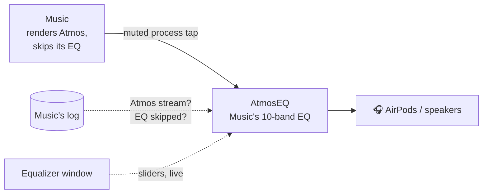
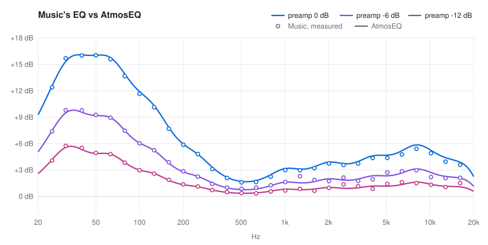
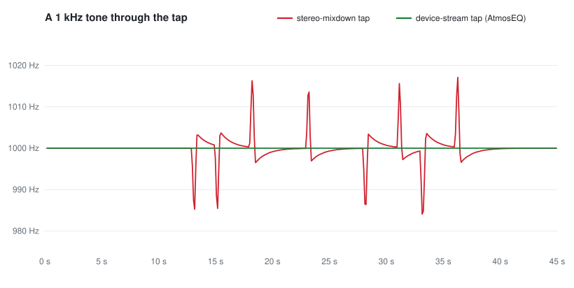

<div align="center">

# AtmosEQ

**Brings Apple Music's equalizer back for Dolby Atmos tracks on macOS 26 and 27.**


</div>

## The bug

Since macOS 26, Music's EQ is silently skipped whenever a track plays in Dolby Atmos. The Equalizer window still works and stereo tracks are still equalized, but Atmos tracks play flat on every output device. On macOS 15 the EQ applied to Atmos as well.

It has been reported to Apple and is still present in macOS 26.7.1 and the 27.2 developer beta.

## What AtmosEQ does

AtmosEQ is a small command-line helper that runs next to Music:

- It taps Music's output after Music has rendered Atmos, so spatial rendering and head tracking are untouched.
- It applies the EQ Music would have applied. The filter design and the preamp behaviour were measured from Music itself and match within about 0.3 dB.
- It reads the sliders from Music's own Equalizer window, so you keep using that window as before. Changes apply while you drag.
- It only steps in when the stream that is playing is an Atmos stream and Music has skipped its own EQ on it. Stereo tracks pass through untouched, so nothing is equalized twice.
- Its audio stream runs only while Music is playing, so it does not keep your headphones or your Mac awake.



The EQ AtmosEQ applies, against Music's own EQ measured on a stereo track with the same sliders:

<picture>
  <source media="(prefers-color-scheme: dark)" srcset="docs/eq-response-dark.svg">
  
</picture>

## Requirements

- macOS 26 or later, on an administrator account (the helper reads Music's log lines with `/usr/bin/log`)
- Xcode or the Command Line Tools, for `swiftc`
- Music's EQ switched on (Window > Equalizer)

## Build and run

```sh
make          # or: swiftc -O -swift-version 5 main.swift -o atmoseq
./atmoseq
```

Leave it running in a terminal. Ctrl-C stops it and Music plays as before.

### Start at login

```sh
make install
```

This builds `AtmosEQ.app` (a small launcher), puts it in `~/Applications`, installs the engine in `~/Library/Application Support/AtmosEQ`, and registers a login item (a LaunchAgent, so it also comes back if it ever crashes). It has no window or menu bar icon; what it is doing is in `~/Library/Logs/AtmosEQ.log`. It never launches Music by itself and sits idle until Music plays.

`make uninstall` stops it and removes the app, the login item and its permission entries.

Permissions belong to the launcher app, which is ad-hoc signed; macOS ties them to its exact build. Engine changes keep them. A changed launcher makes the installer clear the old entries, and macOS asks again.

On first install, add AtmosEQ by hand under System Settings > Privacy & Security > Screen & System Audio Recording (the **+** button, or drag it in from `~/Applications`): an app started in the background is not added to that list automatically. Until then it waits and Music plays untouched.

A normal session looks like this:

```
tap ready on AirPods Pro @ 48000 Hz, 2 ch (device-stream tap, no drift compensation)
playing → tap running
EQ "Manual": preamp -2.8 dB (EQ strength 73%), bands 12.0 8.6 4.6 2.0 0.0 2.2 2.4 2.5 3.8 3.3
Atmos stream, Music skipped its EQ → applying "Manual"
passthrough: stereo stream 865 — Music's own EQ handles it
stopped → tap idle (device free to sleep)
```

## Permissions

macOS checks these against the app the helper runs under: your terminal app, or AtmosEQ when it is installed as a login item:

| Permission | Needed for | Without it |
|---|---|---|
| Screen Recording (the "Screen & System Audio Recording" list), or System Audio Recording | the audio tap | The tap delivers silence. The helper notices within a few seconds and lets go, so Music is audible again. |
| Automation → Music | reading preset values by name | No EQ values when the Equalizer window is closed. |
| Accessibility | reading the Equalizer window's sliders live | It follows one preset by name (`--preset`, default `Manual`) with a short delay. |

## The preamp

Music's preamp is not a volume control. It sets how much of the EQ is applied:

| Preamp | EQ strength |
|---|---|
| 0 dB | 100% (the sliders as shown) |
| −6 dB | 50% of the boost |
| −12 dB | 25% of the boost |
| above 0 dB | more than the sliders show, up to a ceiling |

Music itself only reads the preamp when a track starts. AtmosEQ applies it while you drag. The chart above shows the same sliders at three preamp settings.

## Options

| Option | Effect |
|---|---|
| `--preset NAME` | Preset to follow while the Equalizer window is closed. Default: the last one seen in that window, else `Manual`. |
| `--preamp DB` | Use this preamp instead of Music's slider. |
| `--always` | Apply the EQ to everything and ignore Music's log. Switch Music's own EQ off if you use this. |
| `--test SECONDS` | Silent self-test. Outputs nothing and records the audio before and after the EQ to `test-dry.wav` and `test-eq.wav`. |
| `--target PID` | With `--test`: tap another process instead of Music (it is muted). Used with `research/tonegen`. |
| `--replay WINDOW` | Diagnostic. Runs Music's log history (for example `30m`) through the decision logic, prints every change of mind, and exits. |

## Status and limits

- Tested on macOS 26.7.1 (25G241) with Music 1.6.6 and AirPods Pro 3. It follows output changes and has also attached to AirPods Max and the built-in speakers.
- There is no menu bar icon or settings window. As a login item its only output is the log file.
- The login item uses Screen Recording, not System Audio Recording, on purpose: coreaudiod accepts either for a tap, and only the System Audio Recording route turns on the purple recording indicator in the menu bar. Screen Recording is the broader permission; AtmosEQ never captures the screen. The app bundle has no audio-capture usage string, so macOS refuses the narrower permission without asking and falls back to Screen Recording.
- It depends on four log messages from the Music process: `EQEffectsProcessor::Prepare/Unprepare stream`, `EQEffectsProcessor::SetEQSettings`, `Created new AudioQueue for format` and `faqrp_startTimebaseCommon … calling CMTimebaseSetRateAndAnchorTime`. If a macOS update removes them, the helper stops adding EQ and Atmos plays flat again; it never stacks a second EQ on a stereo track.
- When an Atmos track is followed by a stereo one, the handover to Music's own EQ waits for a log line. If playback restarts between the two tracks, which is the usual case, the helper holds back until it knows which stream started. On a truly gapless change the first fraction of a second of the stereo track can get both EQs.
- Only boosts were measured. Sliders below 0 dB are assumed to mirror boosts.
- If Music plays to something other than the system output device, such as AirPlay, there is nothing to tap and the helper stays idle.
- The tap adds about one audio buffer of delay (roughly 10 ms).

## How it works

[FINDINGS.md](FINDINGS.md) has the investigation: why Music skips the EQ, why the tap has to be clocked by the output device, and how Music's EQ and preamp were identified.

The clock problem is why the first build made track starts sound slowed down. During Atmos playback the AirPods' Bluetooth driver keeps nudging its delivery speed. A tap with its own clock turns every nudge into a pitch bend; a tap clocked by the output device, which AtmosEQ uses, does not:

<picture>
  <source media="(prefers-color-scheme: dark)" srcset="docs/tone-pitch-dark.svg">
  
</picture>

The tools used for those measurements are in [research/](research/).

## Disclaimer

This project is not affiliated with Apple or Dolby. Apple Music, AirPods and Dolby Atmos are trademarks of their respective owners.
